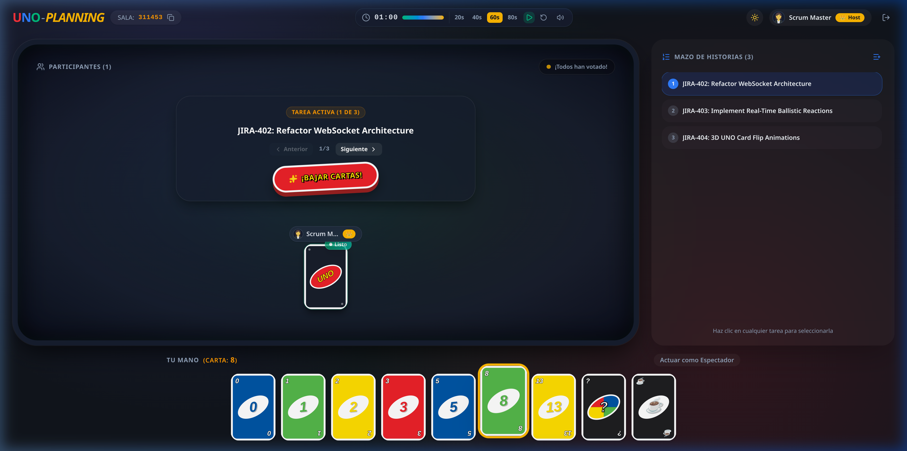
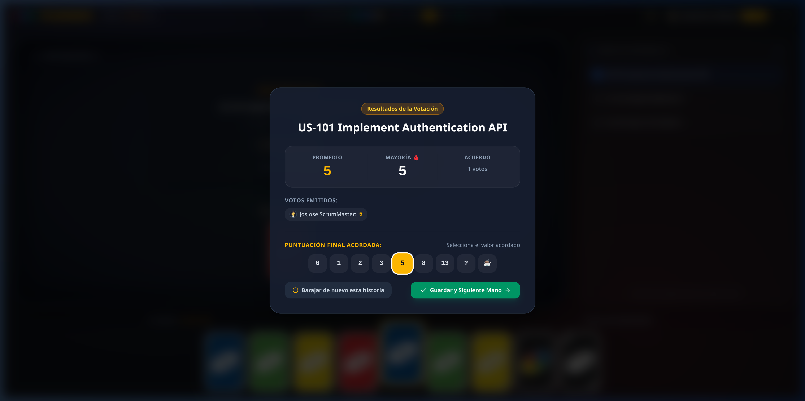

# 🃏 UNO-PLANNING

<p align="center">
  
</p>

<p align="center">
  <strong>Fast, playful, and distraction-free agile estimation powered by the iconic UNO card game and real-time WebSockets.</strong>
</p>

<p align="center">
  <a href="https://uno-planning.onrender.com/"></a>
  <a href="#-technology-stack"></a>
  <a href="#-technology-stack"></a>
  <a href="#-technology-stack"></a>
  <a href="#-100-ephemeral--zero-knowledge-privacy"></a>
  <a href="LICENSE"></a>
</p>

<p align="center">
  <a href="#-overview">Overview</a> •
  <a href="#-why-teams-love-it-key-features">Key Features</a> •
  <a href="#-visual-tour">Visual Tour</a> •
  <a href="#-technology-stack">Tech Stack</a> •
  <a href="#-local-development-setup">Getting Started</a> •
  <a href="#-automated-testing--verification">Testing</a> •
  <a href="#-license">License</a>
</p>

---

## 🌟 Overview

**UNO-PLANNING** transforms Agile Story Point estimation from an exhausting corporate ritual into an engaging, high-energy team ritual. Inspired by the timeless visual geometry and vibrant color palette of the beloved **UNO card game**, it combines tactile animations, spatial audio, and comic interactions with an uncompromising commitment to privacy.

### The Problem with Traditional Poker Planning
- **Ceremony Fatigue**: Monotonous, sterile UIs sap engineering momentum during sprint planning.
- **Privacy Intrusion**: Many online planning tools demand mandatory logins, corporate SSO permissions, and store proprietary backlog tickets on external third-party databases.
- **Awkward Silences & Bias**: Unanchored discussions drag on without rhythm, while extroverted voices disproportionately skew story point consensus.

### The UNO-PLANNING Solution
UNO-PLANNING solves this with a **100% ephemeral in-memory architecture**, sub-millisecond WebSocket room synchronization, a synchronized Zen countdown timer with browser-synthesized audio, and ballistic anonymous reactions to keep team energy alive.

🎮 **Try it right now with your team**: **[https://uno-planning.onrender.com/](https://uno-planning.onrender.com/)**

---

## ✨ Why Teams Love It (Key Features)

### 🃏 1. UNO-Themed Fibonacci Deck & Smart Wildcards
- **Fibonacci Sequence**: 9 balanced estimation cards (`0`, `1`, `2`, `3`, `5`, `8`, `13`, `?`, `☕`).
- **Signature UNO Color Sequence**: Numbers cyclically rotate through official UNO colors: **Blue** (`#0054A6`), **Green** (`#54B948`), **Yellow** (`#FFDE00`), and **Red** (`#ED1C24`).
- **Clarification Wildcard (`?`)**: When a developer plays the `?` card, the room timer **immediately pauses**, triggering a high-priority "Clarification Needed" modal across all screens so the team can align on technical doubts before voting resumes.
- **Break Wildcard (`☕`)**: Flags tasks requiring decomposition or signals coffee/break time.

### 🎭 2. 3D Card Flip Animation & "¡BAJAR CARTAS!" Action
- Votes remain strictly hidden behind the iconic 3D "POKER" card back while the round is active.
- Players selecting a card trigger a tactile **Card Snap** acoustic thud and receive a glowing "Listo" (Ready) badge on the felt table.
- When ready, the Scrum Master triggers the central 3D UNO button: **¡BAJAR CARTAS!**, flipping all cards in fluid, hardware-accelerated 3D space simultaneously.

### 📊 3. Instant Metrics, Consensus Fanfare & Outlier Highlights
- **Real-Time Analytics**: Automatic calculation of **Arithmetic Average** (rounded to 1 decimal) and **Statistical Mode (Majority)**.
- **¡UNO! Total Consensus**: 100% agreement unlocks an explosive celebratory canvas confetti shower accompanied by a victory fanfare chord.
- **Automated Outlier Contrast**: If estimates diverge, the results modal automatically highlights the **Lowest Score** and **Highest Score** alongside their voters, allowing the Scrum Master to spark targeted, respectful technical debate without finger-pointing.

### 🚀 4. Ballistic Parabolic Comic Reactions
- **9 Humorous Emoji Projectiles**: `☕` Coffee, `🍅` Tomato, `🔥` Fire, `🔪` Knife, `🧱` Brick, `💩` Poop, `💀` Skull, `👾` Alien, and `⏰` Clock.
- **GPU-Accelerated Flight Arcs**: Emojis launch from randomized screen borders in dynamic parabolic ballistic arcs with 3D elevation, directional spin, and wobble impacts directly against teammate cards.
- **100% Anonymous**: The server strips sender identities before broadcasting, allowing safe, fun interaction without social friction.

### ⏱️ 5. Zen Round Timer & Browser-Synthesized Audio (Web Audio API)
- **Host-Controlled Countdowns**: Choose between 20s, 40s, 60s, or 80s presets with smooth circular progress bars.
- **Zero External Audio Files**: Zero network lag and zero audio downloads. Every chime is synthesized mathematically in real-time via the browser's native **Web Audio API**:
  - *Start Tone*: Ascending two-tone chime (C5 → G5).
  - *Midpoint Bell*: Harmonic chime at 50% remaining time.
  - *Woodblock Ticks*: Gentle countdown ticks in the final 5 seconds (5.. 4.. 3.. 2.. 1).
  - *Zen Bowl Finale*: Harmonic Tibetan singing bowl chord when time runs out.
- **Automatic Reveal**: Automatically flips all cards upon reaching 00:00.
- **Persistent Local Mute**: Individual mute toggle remembered across browser visits.

### 📋 6. Integrated Jira, Linear & Backlog Story Queue
- Paste task titles, user stories, or direct issue links (Jira, Linear, GitHub, Notion, Trello).
- The active story is prominently featured on the table felt; clicking URLs launches tickets in a new browser tab.
- **Reactive Auto-Scroll**: The persistent sidebar queue automatically scrolls to keep the active story in viewport focus.
- Record accepted scores directly to stories and navigate smoothly between tasks.

### 👑 7. Host Onboarding Tour & Anti-Hijacking Security
- **Interactive Spotlight Tour**: First-time Scrum Masters are welcomed by an SVG-masked spotlight highlighting the Timer, Story Queue, and Reveal button with concise 1-2 sentence guides.
- **Cryptographic Host Token**: Unguessable 32-character hex tokens stored in `sessionStorage` prevent room hijacking and preserve host privileges across browser refreshes (`F5`) or network flickers.

### 👥 8. Spectator Mode & Generative Avatars
- **Non-Skewing Observer Mode**: Product Owners, stakeholders, or guests can toggle Spectator mode at any time (`👀`). Spectators do not distort averages or block unanimity checks.
- **DiceBear Generative Avatars**: Deterministic, colorful avatars with a one-click dice randomize button (`🎲`).

### 🌓 9. Dynamic Dark & Light Themes
- Seamlessly switch between the rich green poker table felt in **Dark Mode** and the crisp, high-contrast **Light Mode**. Theme preferences persist in `localStorage`.

### 🔒 10. 100% Ephemeral & Zero-Knowledge Privacy
- **Zero Databases**: No MongoDB, no PostgreSQL, no Firebase, and zero Redis. All state lives strictly in server RAM.
- **Instant Evaporation**: When the last participant leaves, the room and its tasks are immediately destroyed from memory.
- **Automated Janitor**: Scheduled sweeps safely discard abandoned sessions after 8 hours of inactivity.
- **Rate-Limiting & Dos Protection**: Strict token-bucket sliding-window rate limiters prevent socket flooding, and task queues are capped at 50 items and 300 characters per story.

---

## 📸 Visual Tour

<div align="center">
  
  <p><em>The active poker room table with live voter presence, Jira backlog queue, and synchronized timer.</em></p>
</div>

<br />

<div align="center">
  
  <p><em>Automated metrics modal with unanimous consensus celebration, average, mode, and outlier debate highlights.</em></p>
</div>

---

## 🛠️ Technology Stack

UNO-PLANNING is built on a modern, robust, and lightweight JavaScript stack:

### Frontend
| Technology | Role | Highlights |
| :--- | :--- | :--- |
| **[React 19](https://react.dev/)** | Core UI Engine | Modern reactive architecture with zero legacy lifecycle dependencies. |
| **[Vite 8](https://vitejs.dev/)** | Build Tooling | Instant Hot Module Replacement (HMR) and optimized rollup production bundles. |
| **[Tailwind CSS v4](https://tailwindcss.com/)** | Styling Engine | Blazing-fast styling via `@tailwindcss/vite` with custom 3D card perspectives. |
| **[Socket.io Client 4](https://socket.io/)** | Real-Time Sync | Resilient WebSocket transport with automatic reconnection and state resync. |
| **Web Audio API** | Native Soundscapes | Browser-synthesized audio tones with zero external media files. |
| **[Lucide React](https://lucide.dev/)** | Iconography | Clean, accessible vector icons. |
| **[Canvas Confetti](https://www.npmjs.com/package/canvas-confetti)** | Visual Effects | High-performance particle physics celebration for unanimous consensus. |
| **[DiceBear API](https://www.dicebear.com/)** | Avatar Generation | Seed-based, deterministic generative user avatars. |

### Backend
| Technology | Role | Highlights |
| :--- | :--- | :--- |
| **[Node.js](https://nodejs.org/)** (LTS) | Runtime | Asynchronous, event-driven JavaScript server environment. |
| **[Express 4](https://expressjs.com/)** | HTTP Server | Minimalist server serving optimized static production assets. |
| **[Socket.io 4](https://socket.io/)** | Authoritative WebSocket Server | Real-time state synchronization, anonymous event broadcasting, and lifecycle timers. |
| **[Helmet](https://helmetjs.github.io/)** | HTTP Security Headers | Strict Content Security Policy (CSP), clickjacking prevention, and `X-Powered-By` masking. |
| **`node:crypto`** | Cryptography | Secure 6-character room IDs and 32-character host authentication tokens. |
| **In-Memory Rate Limiter** | Traffic Governance | Sliding-window bucket limiting socket spam and message flooding. |

---

## 📋 System Requirements

| Requirement | Recommended Version | Minimum Version | Notes |
| :--- | :--- | :--- | :--- |
| **Node.js** | `v20.x LTS` or `v22.x LTS` | `v18.11.0+` | Node 18.11+ required for native `--watch` dev flag. |
| **npm** | `v9.x+` or `v10.x+` | `v9.0.0+` | Bundled with modern Node.js installations. |
| **Browser** | Evergreen (Chrome, Firefox, Safari, Edge) | Modern | Must support WebSockets and Web Audio API. |

---

## 🚀 Local Development Setup

Get your local environment running in less than 2 minutes:

### 1. Clone the repository
```bash
git clone https://github.com/ArturoHerrera/uno-planning.git
cd uno-planning
```

### 2. Install dependencies
Install dependencies for both the root backend and the React frontend client:
```bash
npm install
npm --prefix client install
```

### 3. Start development servers
Run the backend server (with live code reloading via `node --watch`) and the Vite client concurrently:
```bash
npm run dev
```

Once started:
- 🌐 **Client (Frontend)**: Open [http://localhost:5173](http://localhost:5173) in your browser.
- ⚙️ **Server (Backend)**: Running at [http://localhost:3000](http://localhost:3000).

---

## 🧪 Automated Testing & Verification

The project includes built-in test suites covering security audits, rate-limiting rules, and multi-client game simulations:

```bash
# 1. Run the 7-step security & rate-limiting audit (headers, tokens, anti-hijacking, input validation)
npm run test:security

# 2. Run the end-to-end multi-client simulation (room creation, voting, consensus, timer, ballistic reactions)
npm run test:e2e
```

---

## 📦 Production Build & Local Preview

To compile the optimized client production bundle and run the unified Express production server locally:

```bash
# 1. Compile the frontend client bundle
npm run build

# 2. Launch the production server
npm start
```

Visit [http://localhost:3000](http://localhost:3000) to test the production build.

---

## 🌐 Public Demo

Try the live production deployment hosted on Render:
🎮 **[https://uno-planning.onrender.com/](https://uno-planning.onrender.com/)**

---

## 📄 License

This project is open-source and licensed under the **[MIT License](LICENSE)**.
